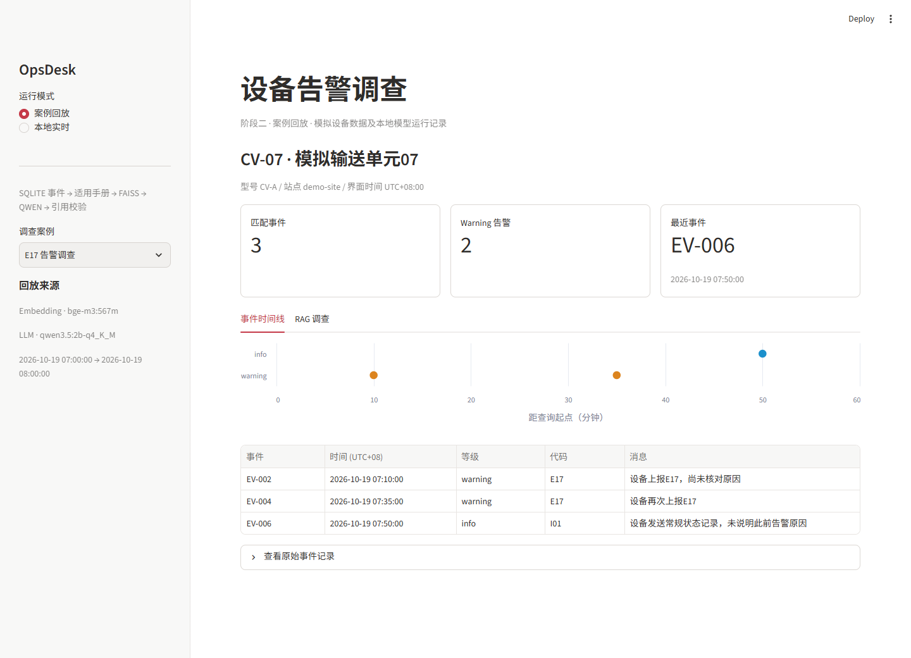
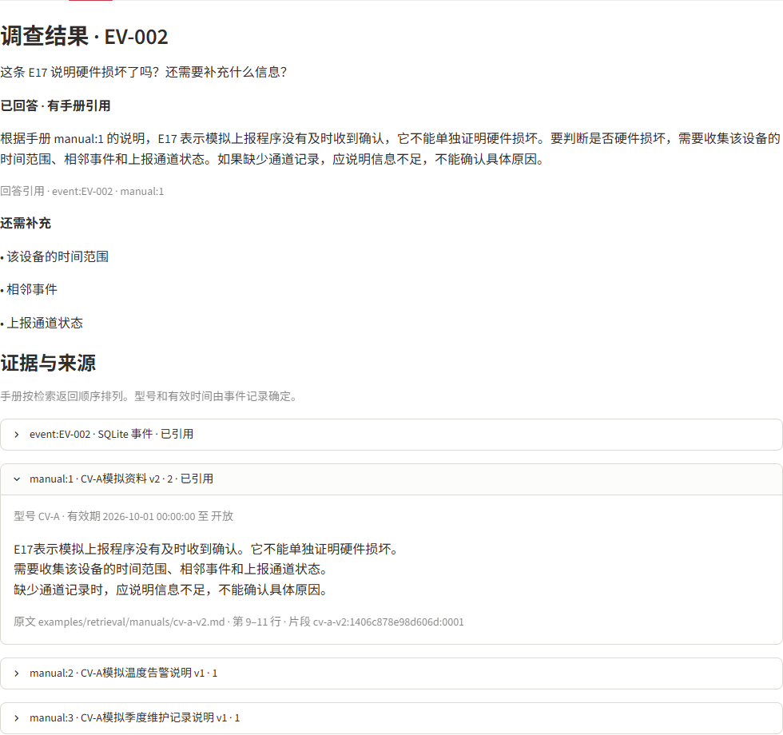

# OpsDesk Agent

面向工业与运维场景的**可追溯设备告警调查助手**。支持设备事件结构化查询、基于型号与有效期的手册适用性过滤（FAISS 检索）、受控 LangChain Agent 取证，以及支持跨进程中断恢复（Human-in-the-Loop）的 LangGraph 调查工作流。

---

## 🌐 在线交互演示

无需安装任何环境或模型，浏览器直接体验模拟设备数据与本地 Qwen 实跑记录：

- **[打开 RAG 告警调查演示](https://kkkarven.github.io/opsdesk-agent/demo/)**：以 **CV-07 / EV-002** 告警为起点，核对手册生效时间、展开原始事件与手册正文，验证回答引用的精确来源。
- **[打开调查工作流在线回放](https://kkkarven.github.io/opsdesk-agent/demo/workflow.html)**：查看 LangGraph 任务如何因事件编号缺失而自动暂停挂起（Interrupt），在新进程中读取后由人工注入参数原地恢复（Resume）。

<details open>
<summary>设备事件与时间线</summary>



</details>

<details>
<summary>RAG 调查、引用与手册原文</summary>



</details>

---

## 🏗️ 核心架构与能力四阶段

```
[1. B端数据底座]   JSON 校验归档 ──> 幂等入库/隔离区 ──> SQLite 持久化 ──> FastAPI 接口
                                                           │
[2. 本地确定性 RAG] Markdown 解析 ──> 型号+时间硬过滤 ──> BGE-M3 + FAISS ──> 强制枚举引用
                                                           │
[3. 受控 LangChain Agent] 意图路由 ──> 中间件轨道拦截 ──> 强制取证回执 ──> 报告自修复重试
                                                           │
[4. 可恢复 LangGraph] 状态图编排 ──> 自适应二次补检 ──> 检查点持久化 ──> 跨进程中断恢复
```

1. **工业级数据底座（SQLite + FastAPI + Pydantic V2）**
   - 批次 SHA-256 幂等导入、同 ID 冲突保护、数据隔离区（Quarantine Pattern）与原始 JSON 归档。
   - 聚合统计（全窗口）与明细列表（受 Limit 限制）分离查询，主动附带 `data_quality` 完整性提示。
   - 全链路 `X-Request-ID` 与微秒级耗时中间件。

2. **本地确定性 RAG（BGE-M3 + FAISS + Qwen）**
   - **时空前置过滤（Pre-filtering）**：严格校验设备型号与事件发生时间（`[valid_from, valid_to)` 左闭右开区间），淘汰失效及跨型号资料。
   - **L2 归一化内积**：利用数学等价性将余弦相似度转化为 `faiss.IndexFlatIP` 内积加速，生成带校验和的 `.npz` 快照。
   - **防幻觉引用**：动态将候选来源 Key 注入 JSON Schema 的 `enum` 枚举中，从采样物理层阻断胡乱编造引用的可能。

3. **受控 LangChain Agent（Router + Collector + Reporter）**
   - **三阶段职责分离**：任务路由（Router）➔ 严格按依赖取证（Collector）➔ 去工具化撰写报告（Reporter）。
   - **中间件轨道拦截**：利用 `@wrap_model_call` 动态改写每轮可用工具，防止 2B 本地小模型跳步与死循环；强制提交 `CollectionDone` 握手回执；单次错误反馈自修复重试。

4. **持久化 LangGraph 工作流（StateGraph + SqliteSaver）**
   - **自适应二次补检（Adaptive Loop）**：初次检索证据不足且存在明确补检词时，在预算充足前提下自动触发补检再回答。
   - **Human-in-the-Loop 恢复**：目标未定位或参数缺失时通过 `interrupt()` 挂起，基于 `SqliteSaver` 和文件锁跨进程安全持久化，随时可通过 CLI 或 Streamlit 原地唤醒（Resume）。

---

## 🛠️ 技术栈

| 领域 | 核心技术 | 作用 |
| :--- | :--- | :--- |
| **Agent & 编排** | LangChain 1.4 / LangGraph 1.2 / LangGraph-Checkpoint-SQLite | 状态机拓扑、中间件拦截、检查点持久化、中断恢复 |
| **本地模型** | Ollama / `bge-m3:567m` / `qwen3.5:2b-q4_K_M` | 本地 Embedding 与结构化推理（温度 0、严格 JSON Schema） |
| **向量检索** | FAISS CPU / NumPy 2 | 候选向量切片、L2 归一化内积排序、原子快照持久化 |
| **后端与数据** | FastAPI / SQLite3 / Pydantic V2 / HTTPX | RESTful 接口、全链路日志、数据导入校验、ACID 事务 |
| **交互与前端** | Streamlit / Altair / 原生 HTML5 & JS | 本地运维控制台、散点图时间线、静态离线回放 |
| **质量工程** | pytest 9.1 | 63 项单元测试与端到端回归测试 |

---

## 🚀 本地快速启动

### 1. 环境准备 (推荐 WSL Ubuntu / Linux)

```bash
git clone https://github.com/kkkarven/opsdesk-agent.git
cd opsdesk-agent

python3 -m venv .venv
source .venv/bin/activate
python -m pip install -e ".[dev,agent,workflow,demo]"
```

若需本地实时推理，请先在另一个终端启动 Ollama 并拉取模型：
```bash
ollama pull bge-m3:567m
ollama pull qwen3.5:2b-q4_K_M
```

### 2. 初始化数据与知识库建库

```bash
# 初始化数据库并导入示例数据
opsdesk init
opsdesk import examples/normal

# 构建手册向量快照
opsdesk knowledge-build examples/retrieval/manuals
```

---

## 💻 运行入口

### ① 启动 Streamlit 双页面运维控制台
```bash
python -m streamlit run streamlit_app.py --server.address 127.0.0.1
```
- **主页面**：设备事件时间线（Altair 散点图）、明细下钻与固定 RAG 调查。
- **侧边栏工作流页（pages/调查工作流.py）**：体验 LangGraph 实时任务启动、挂起等待输入与断点恢复。

### ② 启动 FastAPI 后端服务
```bash
OPSDESK_DATA_DIR="$PWD/data" python -m uvicorn opsdesk.api:create_app --factory --host 127.0.0.1 --port 8000
```
- 交互式 Swagger 文档：`http://127.0.0.1:8000/docs`
- 提供设备查询、时间窗口事件聚合、坏记录列表及归档文件下载。

### ③ 运行 LangChain 受控 Agent 调查
```bash
python -m opsdesk.agent CV-07 \
  --start "2026-10-19T07:00:00+08:00" \
  --end "2026-10-19T08:00:00+08:00" \
  --event-id EV-002 \
  --question "结合这条 E17 告警，能证明硬件损坏了吗？"
```

### ④ 运行 LangGraph 可恢复工作流
```bash
# 故意省略 --event-id，触发中断挂起
python -m opsdesk.workflow start CV-07 \
  --start "2026-10-19T07:00:00+08:00" \
  --end "2026-10-19T08:00:00+08:00" \
  --question "这条告警能证明硬件损坏吗？"

# 复制终端返回的 task_id，人工注入正确的 event-id 原地唤醒恢复
python -m opsdesk.workflow resume <TASK_ID> --event-id EV-002
```

---

## 🧪 自动化测试与质量保障

项目配备了严格的自动化回归测试，不依赖外部在线网络：

```bash
python -m pytest
```

```text
============================== 63 passed in 2.49s ==============================
```
- `test_stage1.py`：数据清洗、导入幂等性、坏记录隔离与 FastAPI 路由。
- `test_knowledge.py`：Markdown 元数据提取、时空左闭右开区间过滤。
- `test_embeddings.py` & `test_retrieval.py`：向量维度一致性、L2 归一化与 FAISS 排序。
- `test_retrieval_snapshot.py`：`.npz` 快照原子替换、SHA-256 校验与漂移审计。
- `test_rag.py`：固定 RAG 流程、Schema 枚举防幻觉约束与缺失引用拦截。
- `test_agent.py`：受控 Agent 路由、中间件工具调度与报告自修复重试。
- `test_workflow.py`：LangGraph 状态流转、自适应二次补检闭环、跨进程恢复与预算拦截。

---

## 📂 模块映射

```text
src/opsdesk/
├── config.py           # 路径与环境变量配置
├── schemas.py          # Pydantic V2 强类型约束与带时区 UTC 转换
├── storage.py          # 原生 SQLite 连接、表结构与复合索引
├── ingestion.py        # 归档校验、批次哈希去重与坏数据隔离
├── service.py          # 聚合统计与数据质量评估
├── api.py              # FastAPI 路由、防御性文件下载与错误处理
├── request_logging.py  # 全链路 X-Request-ID 与耗时监控中间件
├── knowledge.py        # Markdown 资料解析与时空有效性匹配
├── embeddings.py       # 本地 BGE-M3 向量接口与异常防御
├── retrieval.py        # 向量 L2 归一化、FAISS 局部排序与安全快照
├── rag.py              # 动态 Schema 枚举锁死引用的 RAG 解释器
├── agent_tools.py      # content_and_artifact 双返回值工具与本地缓存
├── agent.py            # LangChain 受控 Agent（Router + Collector + Reporter）
├── workflow.py         # LangGraph 7 节点可恢复工作流与 SqliteSaver
└── cli.py              # 统一命令行入口 (opsdesk)
```

---

## 📄 License

MIT License
