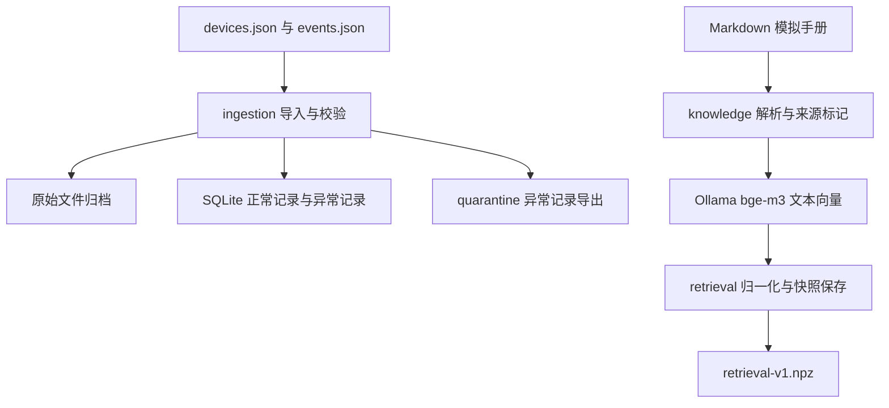
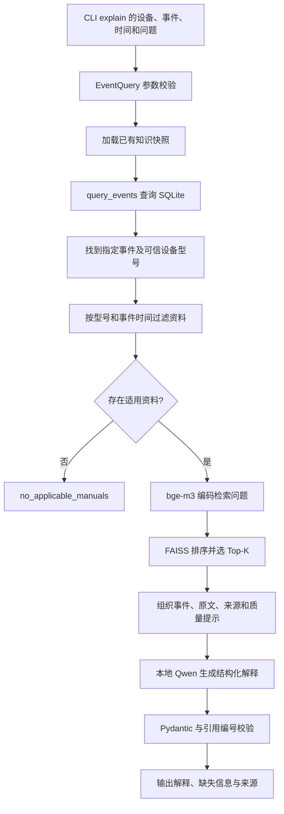

# OpsDesk：第二阶段回顾与项目技术栈

整理日期：2026-10-30。项目目录：`/home/hp/projects/opsdesk-rebuild`。

本文结合当前源码、本轮测试和对话中的实际模型输出，总结第一、第二阶段已经形成的能力。后续规划单独说明，不计入当前实现。

## 1. 现在的项目能做什么

OpsDesk 是一个设备事件数据服务与本地 RAG 解释应用。

第一阶段解决“事件数据能否可靠保存、查询和回查来源”。第二阶段在此基础上解决“能否找到适用于这条事件的资料，并据此解释事件”。

典型使用场景：

> 用户指定 CV-07 的 EV-002，询问 E17 是否说明硬件损坏，以及还需要补充什么信息。

程序读取数据库中的事件与设备型号，用事件发生时间选择适用的手册版本，对候选资料做向量排序，再让本地 Qwen 根据事件和手册组织解释。输出同时包含事件来源、手册原文、引用编号和缺失信息。

当前交付范围是可使用的固定 RAG 实验版：

| 已实现 | 当前入口 |
|---|---|
| JSON 导入、校验、归档、异常隔离、SQLite 保存 | CLI |
| 设备、事件、统计、坏记录与原始来源查询 | HTTP API |
| Markdown 资料解析、适用性筛选、向量检索 | Python 模块 |
| 建立知识快照、解释单条指定事件 | CLI |

第二阶段的 RAG 尚未接入 HTTP 路由。当前也没有 LangChain Agent、LangGraph 流程、Docker 配置或工单闭环。

## 2. 整体结构与数据流

### 2.1 两类输入、两条准备流程

设备事件属于结构化事实，手册属于解释资料。两者采用不同方式保存和检索。



SQLite 回答“指定设备、时间段内有哪些事件”。向量检索回答“哪些适用资料与这次问题更相关”。准确的设备编号、时间条件和事件统计继续交给 SQL 处理。

### 2.2 一次解释请求



固定流程指这些调用的先后顺序由 Python 决定。当前模型负责组织解释，没有自主选择并执行工具的循环。

## 3. 第一阶段提供了哪些基础

### 3.1 数据清洗与校验

本项目中的“清洗”主要指检查输入是否合法、隔离不能使用的记录、统一时间表示并保护原始数据。当前没有做统计插补、信号滤波或训练数据增强。

导入时读取 `devices.json`、`events.json`，要求文件包含 JSON 数组，拒绝 NaN 等不合法的 JSON 数值常量。Pydantic 检查设备、事件的字段及时间格式；业务逻辑进一步检查设备关联和同编号冲突。

合法记录写入业务表；逐条检查中发现的坏记录保存原文和原因，并导出到隔离目录。整个文件无法解析或顶层结构错误时，导入直接失败，不把它伪装成正常记录。

### 3.2 持久化、幂等与来源

SQLite 中有四张主要表：

| 表 | 保存内容 |
|---|---|
| `imports` | 导入批次、时间和结果 |
| `devices` | 设备信息、原始记录及批次位置 |
| `events` | 事件信息、原始记录及批次位置 |
| `data_issues` | 异常记录、原因及关联信息 |

导入根据文件名、长度和内容计算批次 SHA-256。重复导入同一批数据可返回既有结果；相同编号、相同原始记录可跳过；同编号内容冲突则保留原有数据并记录异常。

原始文件保存在 `data/imports/<batch_id>/`。记录中的 `batch_id` 和 `source_index` 说明它来自哪个批次、数组中的哪个位置；`source_index` 采用从 0 开始的数组位置。来源 HTTP 接口用于读取归档原文件。

### 3.3 查询、统计和数据质量

`Repository` 读取数据库，`service.query_events()` 组织业务结果：设备信息、查询条件、事件数量、等级统计、最近事件、明细与数据质量提示。

`limit` 限制返回的事件明细数量；摘要统计仍基于完整查询范围。坏记录未计入正常统计，因此结果保留“可能不完整”的提示。相关坏记录计数并非精确限制在本次事件时间范围内，提示采用保守表达。

后续出现一条 `info` 事件，不足以证明之前告警已经解除；事件等级与设备最终状态是不同含义。

这些能力是第二阶段的事实来源。RAG 继续调用已有业务函数，避免让模型猜事件数量、设备型号或来源。

## 4. 第二阶段按什么顺序搭建

### 4.1 先建立可解释、可筛选的资料

首先引入三份模拟手册：CV-A 的旧版、新版以及 CV-B 手册。之后增加 CV-A 的 E22 温度告警和季度维护资料。

最终检索演示目录 `examples/retrieval/manuals/` 包含五份资料：

| 文档 ID | 主要作用 |
|---|---|
| `cv-a-v1` | 检查失效旧版能否被排除 |
| `cv-a-v2` | 当前 CV-A 的 E17 解释 |
| `cv-b-v1` | 检查同名 E17 是否错误跨型号匹配 |
| `cv-a-e22-v1` | 与 E17 同型号、同有效期的另一主题 |
| `cv-a-maintenance-v1` | 与告警解释不同的维护记录主题 |

新增同型号、同有效期的不同主题很必要：如果筛选后只剩一份资料，就只能证明过滤有效，无法充分观察向量排序。

### 4.2 将 Markdown 变成 KnowledgeChunk

`knowledge.load_manual()` 读取标题、型号、版本、生效时间、失效时间和正文，生成一个 `KnowledgeChunk`。

当前每份短手册的完整正文作为一个片段，没有实现通用的长文档递归切分、重叠窗口或 token 切分。这样可以保留“含义—限制—补充信息”这一完整解释单元。

| 字段 | 用途 |
|---|---|
| `doc_id` | 文档名，不含扩展名 |
| `chunk_id` | 文档 ID、内容哈希前缀与片段序号组成的标识 |
| `title`、`text` | 标题与原文 |
| `model`、`version` | 适用型号与资料版本 |
| `valid_from`、`valid_to` | 有效时间范围 |
| `source_path`、`line_start`、`line_end` | 文件和原文行号，行号从 1 开始 |
| `content_hash` | 原始文档文本的 SHA-256 |

哈希用于识别内容变化，不能证明文档内容真实或业务解释正确。

### 4.3 先过滤适用性，再比较相关性

`select_applicable()` 使用以下条件：

```text
手册型号 == 设备型号
valid_from <= 事件发生时间
valid_to 为空，或事件发生时间 < valid_to
```

有效区间是左闭右开：到失效时刻，旧手册退出候选。时间必须包含时区。

设备型号来自数据库；手册匹配日期来自该条事件的 `occurred_at`。查询窗口的开始时间不能替代事件时间，尤其是在窗口跨越版本切换时。

先过滤可以避免旧版或其他型号占据 Top-K 名额。缺少设备型号时抛错；型号已知但没有资料时返回空候选，这两种情况分开处理。

### 4.4 接入本地 Embedding 模型

`OllamaEmbedder.embed_texts()` 使用 `bge-m3:567m`，把文本列表转换为向量列表。

建库时输入每个片段的 `chunk.text`。查询时输入“事件码 + 事件消息 + 用户问题”。例如用户只问“这说明硬件损坏了吗”，事件码和消息能补足检索主题。

模型返回后，程序检查向量数量、非空、维度一致、元素为有限数值，并拒绝全零向量。模型或网络错误抛出 `EmbeddingError`，不会假装成“没有检索结果”。

请求使用 `/api/embed`，并设置 `truncate=False`，避免超长内容被服务静默截断。接口与该参数的含义见 [Ollama Embedding 文档](https://docs.ollama.com/api/embed)。

### 4.5 用 NumPy 和 FAISS 完成排序

`normalize_vectors()` 将向量转换为连续的 `float32` 矩阵，并逐行进行 L2 归一化。

设文本向量为 x，查询向量为 q：

```text
L2 长度：       ||x|| = sqrt(x1² + x2² + ... + xD²)
单位向量：      x_hat = x / ||x||
余弦相似度：    cosine(q, x) = (q · x) / (||q|| × ||x||)
归一化后的内积：q_hat · x_hat = cosine(q, x)
```

因此，对文档向量和查询向量归一化之后，用 `faiss.IndexFlatIP` 比较内积，就对应余弦相似度排序。FAISS 对该用法的说明见 [MetricType and distances](https://github.com/facebookresearch/faiss/wiki/MetricType-and-distances)。

矩阵中每一行对应一个片段。`_row_by_id` 保留片段 ID 与矩阵行的关系。检索时先选出合法片段对应的行，再建立该候选集合的 FAISS 索引；FAISS 返回的局部位置映射回候选片段。

`IndexFlatIP` 在当前候选中进行精确内积搜索，没有使用近似索引。小规模资料下，结构清楚，也方便检验排序。

Top-K 只表示取排名靠前的 K 个候选，分数不是“答案正确的概率”。当前 RAG 使用 `top_k=3`，没有经过校准的最低相关性阈值。因此输出三份候选，可能同时包含 E17、E22 和维护资料；最终回答应引用真正支持解释的那份。

### 4.6 保存快照，使重启后可以继续使用

`VectorRetriever.save()` 保存 `data/knowledge/retrieval-v1.npz`，内容包括：

| 项目 | 保存什么 |
|---|---|
| `metadata` | JSON 文本：格式版本、模型、维度、数量、相似度配置、完整片段 |
| `vectors` | 与片段顺序一致的归一化 `float32` 二维矩阵 |
| `checksum` | 元数据文本和向量字节共同计算的 SHA-256 |

保存时先写同目录临时文件，成功关闭后替换目标文件，以免普通写入失败破坏旧快照。这不是已经实现断电恢复保证的声明。

加载时核对文件字段、校验和、模型、矩阵形状、向量处理配置和片段结构。`np.load(..., allow_pickle=False)` 用于当前数值数组和文本载荷，避免依赖 pickle 对象反序列化；参数说明见 [NumPy load 文档](https://numpy.org/doc/stable/reference/generated/numpy.load.html)。

这里保存的是文档和向量快照，没有直接序列化每次请求临时建立的 FAISS 对象。加载后可以恢复检索器；查询时仍会为适用候选建立索引。

加载快照不调用 Embedding 服务；真正检索时仍需要编码问题。修改源手册不会自动更新快照，需显式运行 `knowledge-build`。模型标签相同但权重已变化的情况，当前没有通过权重摘要自动识别，也应重建。

### 4.7 接入本地生成模型 Qwen

`OllamaChat.generate()` 调用本地 `/api/chat`，使用 `qwen3.5:2b-q4_K_M`。

| 模型 | 在本项目中的任务 |
|---|---|
| `bge-m3:567m` | 编码文档与问题，用于相似度检索 |
| `qwen3.5:2b-q4_K_M` | 阅读提供的上下文，生成解释 |

两个模型都是现成模型，本阶段没有训练或微调它们。向量维度不由聊天模型的参数决定。

当前生成配置：`stream=False`、`think=False`、`temperature=0`、`num_ctx=8192`、`num_predict=1024`。意图是获取一次完整响应，减少短任务的生成开销，限制上下文与输出预算。低温度不保证答案正确。

HTTP 响应先作为外层 JSON 解析，取出 `message.content`；该字段中包含的模型 JSON 文本，再交给业务层解析。网络失败、非正常 HTTP 状态、未完成生成、长度截断和空回答都有错误检查。

### 4.8 把事实、检索和生成连接成 RAG

`rag.explain_event()` 是当前主业务入口，依次执行：

1. 检查问题非空，调用 `query_events()`。
2. 从本次返回明细中找到指定事件。
3. 读取数据库中的型号和事件发生时间。
4. 构造检索问题并取得候选手册。
5. 组织事件来源、手册原文和数据质量提示。
6. 无适用手册时直接返回；有候选时调用 Qwen。
7. 校验回答结构和引用，返回完整结果。

RAG 是 Retrieval-Augmented Generation，意思是“用检索得到的资料辅助生成”。当前资料通过请求上下文交给模型，没有因此写入模型权重。

模型输出采用 `AnswerDraft`：

```json
{
  "status": "answered",
  "explanation": "E17 不能单独证明硬件损坏。",
  "evidence_ids": ["event:EV-002", "manual:1"],
  "missing_information": ["相邻事件", "上报通道状态"]
}
```

JSON Schema 通过 `format` 传给 Ollama，也写入系统消息。Pydantic 随后验证返回结果。这种“提供结构约束，再解析校验”的使用方式可参照 [Ollama Structured Outputs](https://docs.ollama.com/capabilities/structured-outputs)。

`answered` 表示可以回答所问问题，不表示已查明故障原因。对于“能否单凭 E17 证明损坏”，回答“不能，且需要更多信息”本身就是有效回答。

### 4.9 修复实际出现的引用编号问题

曾经出现的报错：

```text
GenerationError: 模型引用了不存在的来源：['EV-002']
```

原因是业务事件编号 `EV-002` 与本次上下文的引用键 `event:EV-002` 同时出现，原 Schema 仅要求字符串列表，没有限制可选值。模型生成了业务编号，程序的后置校验正确地拒绝了它。

修复时，把本次 `sources` 的键写入 Schema 的 `enum`：

```python
schema["properties"]["evidence_ids"]["items"] = {
    "type": "string",
    "enum": list(sources),
}
```

同时在提示中明确使用完整引用键，并保留 Python 中的 `unknown_ids` 检查。前者约束生成，后者验证返回，不依赖模型自觉遵守格式。

`event:EV-002`、`manual:1` 是本次回答内部的引用编号；手册的长期身份和内容对应关系由 `chunk_id`、哈希和来源位置描述。

### 4.10 最后接入正式 CLI

`cli.py` 把现有函数连接成四个子命令：

| 命令 | 调用核心 | 主要结果 |
|---|---|---|
| `init` | `Repository.initialize()` | 初始化 SQLite |
| `import` | `import_dataset()` | 导入数据并报告结果 |
| `knowledge-build` | `load_manuals()` → `from_chunks()` → `save()` | 生成知识快照 |
| `explain` | `load()` → `explain_event()` | 解释指定事件 |

CLI 本身不重复实现检索、数据库查询或生成规则，职责是解析参数、构造依赖、调用业务函数和展示结果。

当前实际 CLI 的 `explain` 没有暴露 `--limit`，使用 `EventQuery` 默认的 200 条明细上限。不要把参考方案中曾出现的可选参数误认为已经落地。目标事件超出返回明细时，会提示检查查询范围和 limit；当前可先缩小时间范围，或在 Python 接口中设置允许的 limit。

## 5. 项目技术栈：为什么需要这些东西

以下安装版本来自 2026-10-30 当前 `.venv`，不是对所有平台的兼容性承诺。

| 技术 | 当前版本或形式 | 用在什么地方 | 为什么使用 |
|---|---|---|---|
| Python | 3.14.4；项目声明 >=3.12 | 全部应用模块 | 连接数据处理、数据库、HTTP 和模型 |
| WSL Ubuntu | 当前开发与运行环境 | Linux 路径、终端、虚拟环境 | 保持项目在同一 Linux 环境中运行 |
| venv / pip | `.venv` | 依赖隔离与安装 | 将当前项目依赖与系统 Python 分开 |
| setuptools / pyproject.toml | 构建配置 | `src` 包发现、依赖和命令入口 | 让包可安装，并注册 `opsdesk` 命令 |
| Pydantic | 2.14.1 | 输入、时间、资料和模型结果 | 在边界处检查数据结构与规则，生成 Schema |
| SQLite / sqlite3 | 本地关系数据库及标准库 | 事实记录、批次、异常和查询 | 支持持久化、事务、关联与精确 SQL 条件 |
| FastAPI | 0.162.0 | 第一阶段 HTTP API | 定义路由、查询参数、错误和交互文档 |
| Uvicorn | 0.54.0 | HTTP 服务进程 | 运行 FastAPI 的 ASGI 应用 |
| argparse | Python 标准库 | 四个 CLI 子命令 | 统一参数、帮助和命令错误处理 |
| HTTPX | 0.28.1 | 请求 Ollama | 处理 JSON、HTTP 状态和超时 |
| Ollama | 本地模型服务 | Embedding 与聊天推理 | 通过本地 HTTP 接口运行用户选定模型 |
| BGE-M3 | `bge-m3:567m` | 文档和查询向量 | 支持当前语义检索任务 |
| Qwen | `qwen3.5:2b-q4_K_M` | 结构化解释 | 使用已有本地小模型组织资料和事实 |
| NumPy | 2.5.4 | 矩阵、归一化与 NPZ | 明确数值类型、行顺序并保存向量 |
| FAISS CPU | 1.15.1 | `IndexFlatIP` | 对适用候选进行向量相似度搜索 |
| JSON / JSON Schema | 数据交换格式与结构约束 | 导入、HTTP、模型输入输出、快照元数据 | 使跨模块数据可解析、可检查 |
| Markdown | 手册与项目文档 | 知识资料、说明 | 易于编辑，便于保留标题和行号 |
| hashlib / SHA-256 | Python 标准库 | 批次、文档和快照摘要 | 识别内容变化并检查快照一致性 |
| logging / uuid / perf_counter | Python 标准库 | HTTP 请求日志 | 记录请求编号、状态和耗时 |
| pytest | 9.1.1 | 自动化检查 | 可复现地验证规则、错误分支与回归 |
| Git | 当前仓库版本管理 | 源码与文档状态 | 查看和追踪修改；测试通过不代表已提交或发布 |

当前没有使用独立向量数据库，也没有 ORM。数据库访问使用 `sqlite3`，向量保存在 NumPy 快照中，由 FAISS 负责排序。

仓库目录 `opsdesk-rebuild`、发行包名 `opsdesk-agent`、Python 导入包 `opsdesk` 和命令名 `opsdesk` 是四个不同层次的名称，当前代码允许它们不同。

## 6. 模块职责与关键接口

| 文件 | 主要职责 | 关键对象或函数 |
|---|---|---|
| `config.py` | 计算数据目录和数据库位置 | `Settings.from_env()`、`db_path` |
| `schemas.py` | 业务输入和时间规则 | `DeviceInput`、`EventInput`、`EventQuery`、`Timestamp` |
| `storage.py` | SQL 与数据库连接 | `Repository` |
| `ingestion.py` | 归档、导入、隔离和冲突处理 | `import_dataset()` |
| `service.py` | 业务结果、统计与来源组织 | `query_events()`、`list_issues()` |
| `api.py` | 第一阶段 HTTP 路由与错误转换 | `create_app()` |
| `request_logging.py` | HTTP 请求日志 | `install_request_logging()` |
| `knowledge.py` | 资料结构、解析与适用性 | `KnowledgeChunk`、`load_manuals()`、`select_applicable()` |
| `embeddings.py` | 本地文本编码适配 | `OllamaEmbedder.embed_texts()` |
| `retrieval.py` | 归一化、排序、保存和加载 | `SearchHit`、`VectorRetriever` |
| `llm.py` | 本地生成接口及协议错误 | `OllamaChat.generate()` |
| `rag.py` | 固定 RAG 业务流程和引用检查 | `AnswerDraft`、`explain_event()` |
| `cli.py` | 参数解析及模块连接 | `main()` |

传入 `Repository`、检索器、Embedding 和聊天模型对象，而不是在 `explain_event()` 内全部创建，有助于复用和测试。测试时可以换成固定返回值的替身，观察流程是否正确。

当前 HTTP 路由：

| 路由 | 功能 |
|---|---|
| `GET /health` | 数据库可访问性检查 |
| `GET /api/devices` | 设备列表 |
| `GET /api/devices/{device_id}/events` | 事件、统计与质量提示 |
| `GET /api/data-issues` | 异常记录查询 |
| `GET /api/sources/{batch_id}/{filename}` | 读取已登记批次的归档文件 |

HTTP 请求带有 `X-Request-ID` 响应头，并记录路径、状态和耗时。当前 CLI 模型调用没有同等完整的请求追踪链。

## 7. 目录与持久化内容

```text
/home/hp/projects/opsdesk-rebuild/
├── pyproject.toml
├── requirements-dev.txt
├── README.md
├── src/opsdesk/                 # 上表中的应用模块
├── tests/
│   ├── test_stage1.py
│   ├── test_knowledge.py
│   ├── test_embeddings.py
│   ├── test_retrieval.py
│   ├── test_retrieval_snapshot.py
│   └── test_rag.py
├── examples/
│   ├── normal/                 # 正常设备、事件与初始三份手册
│   ├── invalid_event/          # 异常事件样例
│   └── retrieval/manuals/      # 当前五份检索演示手册
├── docs/
│   ├── stage1-tests.xml        # 第一阶段历史测试报告
│   └── 第二阶段回顾与项目技术栈.md
└── data/                      # 默认运行目录，Git 忽略
    ├── opsdesk.sqlite3
    ├── imports/<batch_id>/
    ├── quarantine/            # 有异常记录导出时生成
    └── knowledge/retrieval-v1.npz
```

数据目录优先使用 CLI 的 `--data-dir`；未提供时读取 `OPSDESK_DATA_DIR`，再回落到当前工作目录下的 `data`。模型服务地址目前在适配类构造参数中配置，默认 `http://127.0.0.1:11434`。

## 8. 从一次实际输出理解整个系统

已展示的请求是：CV-07、EV-002、2026-10-19 07:00 至 08:00（+08:00），询问 E17 是否说明硬件损坏。

1. SQLite 返回 CV-07 的型号 CV-A，以及 EV-002 的 warning 事件。
2. 输出事件时间为 `2026-10-18T23:10:00.000000+00:00`，它与 `2026-10-19T07:10:00+08:00` 是同一时刻，没有提前一天发生。
3. 过滤排除 CV-A 旧版和 CV-B 手册。
4. 检索得到 `cv-a-v2`、E22 资料和维护资料，三者均满足型号和时间条件。
5. Qwen 依据 `cv-a-v2` 说明 E17 表示未及时收到确认，不能单独证明硬件损坏，并列出缺少的信息。
6. 输出引用 `event:EV-002` 和 `manual:1`；`manual:1` 对应 `cv-a-v2` 的第 9—11 行。

输出中 `sources` 是本次交给模型的来源集合；`answer.evidence_ids` 才是模型声明使用的来源子集。不能把三条候选都当成三条支持结论的证据。

## 9. 如何使用当前项目

### 9.1 安装与前提

需要已经可以运行的 WSL Python 和本地 Ollama。模型安装情况可通过 `ollama list` 检查。

当前项目依赖声明支持直接进行可编辑安装：

```bash
cd /home/hp/projects/opsdesk-rebuild
python3 -m venv .venv
source .venv/bin/activate
python -m pip install -e '.[dev]'
python -m pip check
ollama list
```

本轮没有重新创建独立虚拟环境。上面的安装方式依据当前 `pyproject.toml`，不作为本轮已完成干净环境复现的记录。

`requirements-dev.txt` 仍是较早阶段的固定版本清单，尚未完整记录 NumPy、FAISS 等新增依赖；`pyproject.toml` 已包含当前直接依赖。当前没有完成第二阶段的统一锁版本交付。

### 9.2 导入与建库

```bash
cd /home/hp/projects/opsdesk-rebuild
source .venv/bin/activate

python -m opsdesk.cli init
python -m opsdesk.cli import examples/normal
python -m opsdesk.cli knowledge-build examples/retrieval/manuals
```

建库需要 Embedding 模型服务，会生成或替换当前快照。已经有有效快照时，日常解释不需要重复执行建库。

### 9.3 解释指定事件

```bash
python -m opsdesk.cli explain CV-07 \
  --event-id EV-002 \
  --start '2026-10-19T07:00:00+08:00' \
  --end '2026-10-19T08:00:00+08:00' \
  --question '这条 E17 说明硬件损坏了吗？还需要补充什么信息？'
```

指定独立数据目录时，全局参数放在子命令前，并在导入、建库与解释时使用同一个目录：

```bash
python -m opsdesk.cli --data-dir data explain CV-07 \
  --event-id EV-002 \
  --start '2026-10-19T07:00:00+08:00' \
  --end '2026-10-19T08:00:00+08:00' \
  --question '解释这条事件及现有证据的限制。'
```

`opsdesk` 已在 `pyproject.toml` 注册为相同入口；安装成功后可用它替代 `python -m opsdesk.cli`。

### 9.4 运行第一阶段 HTTP 服务

```bash
OPSDESK_DATA_DIR="$PWD/data" python -m uvicorn \
  opsdesk.api:create_app --factory --host 127.0.0.1 --port 8000
```

在浏览器访问 [本地交互文档](http://127.0.0.1:8000/docs)。这提供现有数据接口，不会自动增加 RAG 分析路由。

### 9.5 执行检查

```bash
python -m pytest
python -m pip check
python -m opsdesk.cli --help
```

## 10. 测试覆盖与当前证据

2026-10-30 本轮重新执行的结果：

```text
python -B -m pytest -p no:cacheprovider
39 passed, 1 warning in 0.80s

python -m pip check
No broken requirements found.
```

| 测试文件 | 项数 | 主要覆盖 |
|---|---:|---|
| `test_stage1.py` | 12 | 第一阶段导入、存储、查询与 HTTP 等行为 |
| `test_knowledge.py` | 8 | 原文位置、型号、版本切换、缺型号和时区等 |
| `test_embeddings.py` | 7 | 请求与响应校验、异常返回和空输入等 |
| `test_retrieval.py` | 5 | 先过滤后排序、归一化、Top-K、模型与维度等 |
| `test_retrieval_snapshot.py` | 4 | 保存加载、模型不符、内容变化、保存失败保护 |
| `test_rag.py` | 3 | 正常来源保留、无手册跳过生成、非法引用拒绝 |
| 合计 | 39 | 程序行为回归证据 |

本轮还执行了 CLI 帮助与 `ollama list`，确认四个子命令存在，两个模型标签均已安装。

证据应分开理解：

| 证据 | 当前能够说明什么 |
|---|---|
| 自动化测试通过 | 这些输入和替身条件下的程序行为符合断言 |
| 对话中展示的真实 Qwen 成功输出 | E17 场景的事实、手册、解释与引用能够连通 |
| 用户报告最终检查完成 | 用户已完成本轮使用检查；未贴出的逐项结果不扩写为独立实测记录 |
| 模拟资料与事件 | 用于工程流程检查，不证明真实设备诊断价值 |

本轮没有重新执行真实模型推理或全部 CLI 场景。现有自动化测试也未覆盖完整 CLI 端到端、真实 Qwen 协议响应和各类生成语义错误。测试通过不能替代这些证据。

已有一个 Starlette TestClient 与 HTTPX 的弃用警告，当前测试仍通过。没有在总结过程中自动改动依赖。

## 11. 已知限制与故障定位

### 11.1 需要保留的限制

- 当前资料、设备和事件均为模拟内容，缺少真实业务效果验证。
- `insufficient_evidence` 回答可能使用手册内容却漏引手册；目前只有 `answered` 分支强制至少一条手册引用。
- 引用编号存在，不等于引用原文支持每句话；当前没有逐条结论的语义支持校验。
- 没有标定检索阈值、重排或独立保留测试集上的效果统计。
- 当前短文档整篇切块；长文档输入、上下文预算与自动裁剪未形成完整策略。
- 快照采用显式重建，没有文档变化监测、增量更新或权重摘要校验。
- 单事件解释依赖查询返回明细，超出默认 200 条明细时可能找不到目标事件；CLI 尚未暴露 limit。
- 当前型号来自设备表，没有建模设备型号随历史时间变化的情况。
- CLI 使用同步模型请求；没有任务队列、流式展示、自动重试或持久化分析任务。
- HTTP API 仍是第一阶段范围；当前未实现认证和权限管理。

### 11.2 从哪一层查问题

| 现象 | 优先检查 |
|---|---|
| 目标事件未返回 | 设备、时间、事件编号、明细截断 |
| 型号缺失报错 | 数据库设备记录，不能让模型猜型号 |
| `no_applicable_manuals` | 型号、事件日期、手册有效期、快照是否更新 |
| 文档向量或查询向量报错 | 模型、服务、HTTP 响应、维度和数值 |
| 候选合法但主题不相关 | 检索问题、切块、排序与 Top-K |
| 快照无法加载 | 路径、模型配置、格式和完整性 |
| 回答格式不合法 | 原始生成内容、JSON Schema、输出截断 |
| 引用不存在 | 模型引用键、Schema 枚举和 sources 映射 |
| 引用存在但解释不被原文支持 | 上下文、提示与真实生成效果 |

没有资料、模型连接失败和模型生成了不受支持的结论，是三个不同问题，应保留各自原因。

## 12. 本阶段建立的知识联系

| 知识 | 在项目中的具体落点 |
|---|---|
| 数据建模 | `KnowledgeChunk` 让文本带上适用条件和出处 |
| 向量表示 | BGE 将问题与正文映射到兼容的向量空间 |
| 数值计算 | NumPy 明确类型、维度与归一化 |
| 相关性检索 | FAISS 对合法候选排序 |
| 持久化 | 保存片段与向量的一致关系，而不只保存数值 |
| 模型接口 | HTTPX 将程序连接到本地 Ollama 服务 |
| 上下文组织 | 把事实、原文、质量提示与用户问题放入同一次请求 |
| 输出契约 | Schema 与 Pydantic 约束和检查模型返回 |
| 可追溯性 | 回答编号可映射到事件归档和手册原文 |
| 分层排错 | 区分查询、过滤、排序、生成和引用错误 |

这些是本阶段已经实际接触和应用的内容，不自动代表全部知识已独立掌握。源码由用户根据参考实现落地、运行和调整；助手提供设计、代码参考、解释、检查支持及本文档。

## 13. 与后续 Agent 阶段如何衔接

第二阶段把确定的业务流程跑通。后续引入 LangChain 时，可以把已有查询和检索能力包装成工具，让模型提出调用请求，再由应用执行工具、回传结果并控制停止。

| 后续技术 | 将解决的问题 | 当前可复用基础 |
|---|---|---|
| LangChain | 工具描述、参数、调用与结果消息循环 | `query_events()`、资料检索和已有模型接口经验 |
| LangGraph | 多步骤状态、条件分支、暂停与恢复 | 已明确的事实、证据、回答及错误边界 |
| Docker | 运行环境、配置、端口和持久化挂载 | 数据目录、模型服务边界、CLI 与 HTTP 启动方式 |

这些组件尚未进入当前代码。引入框架后，型号、时间、数据质量和引用仍应由业务规则约束；框架不会自动解决资料正确性和生成可信度。

## 14. 当前文档状态

本文件是第一、第二阶段的集中回顾。根目录 README 仍保留第一阶段说明，其中“尚未实现模型调用、资料检索”及部分模块描述已经落后于当前代码。`requirements-dev.txt` 也尚未同步为完整的第二阶段依赖清单。

这些是文档和复现交付的待同步项。本次按用户要求新增总结，不改写应用、依赖、旧测试报告或 README，也不执行 Git 提交与发布。

第二阶段的实际增量是：从“可查询、可追溯的设备事件服务”，推进到“能够结合适用资料、使用本地模型解释指定事件的固定 RAG 应用”。后续 Agent 工作以这些已运行的业务模块为基础继续搭建。
